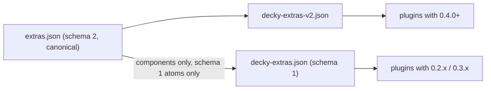

# Design: decky-extras manifest schema 2

Status: draft for review. Nothing in this document is implemented.

## Problem

`@beallio/decky-extras` gives plugins Steam components that `@decky/ui` does not export. Schema 1 can describe only one kind of target: a React component, found by the source text of its function. Plugin developers also need other Steam internals:

- stores and other objects (example: the router history store that holds `m_history`),
- plain functions that are not components (example: Valve's toast renderer),
- classes, found by their prototype methods.

On ES-module clients, `@decky/ui` 5 already exposes module scopes, so it can reach these private variables (48 scopes from 62 modules on beta 1795048523). Schema 1 cannot describe them.

## Goals

- Describe components, functions and objects in one data-only manifest.
- Reach the same values as `@decky/ui`: module scopes on ES-module clients, exports on Webpack clients.
- Keep the schema 1 safety rules: no downloaded code, no regexes, no module IDs, no property paths, unique match or unavailable, validated last-good cache.
- Installed plugins with 0.2.x or 0.3.x must continue to get schema 1 updates.

## Non-goals

- Chunks that Steam loads after the loader starts. Reaching them needs the loader's private `instrumentation/resolve_scope` route. Consider it again after schema 2 ships.
- Steam icons. Issue #42 uses `IconsModule`, which `@decky/ui` already exports.
- Simple values such as numbers, strings and booleans. A module scope is a copy made when the loader reads it, so these values go out of date. A test on 2026-11-24 found this: after the module increased a `let` variable twice, the scope still showed `0`. Objects and functions are the real, live objects, so schema 2 matches only objects and functions.
- Writes to Steam variables. A write to a scope object does not change the module.

## Manifest

```json
{
  "schema": 2,
  "revision": 5,
  "extras": {
    "RadioButton": {
      "kind": "component",
      "title": "Radio button",
      "description": "One option of a radio group.",
      "find": [[{ "text": "\"RadioButton\"" }, { "text": "`RadioButton`" }]]
    },
    "RouterHistoryStore": {
      "kind": "object",
      "title": "Router history store",
      "description": "Steam's routing store; m_history is set after Gaming Mode renders.",
      "find": [[{ "key": "m_history" }], [{ "key": "m_navigator" }], [{ "key": "m_locationPathname" }]]
    }
  }
}
```

Changes from schema 1:

| Item | Schema 1 | Schema 2 |
|---|---|---|
| Entry map | `components` | `extras` |
| Entry type | always a component | `kind`: `component`, `function`, `object` or `class` |
| Name rule | identifier that starts with an upper-case letter | the same rule |
| Source atoms (`text`, `member`, `binding`) | yes | yes, for `component`, `function` and `class` |
| `key` atom | no | yes, for `object` and `class`; identifier rule as for `member` |
| `not` atom | no | `{ "not": <source atom> }`; the clause matches when the atom is absent |
| Limits | 256 entries, 16 clauses of 16 atoms, 64 KiB | the same |

### What each kind matches

The matcher reads each value from the module map that `@decky/ui` returns (`createScopeMapping` on ES-module clients, `createModuleMapping` on Webpack clients). It ignores every value that is not an object or a function.

| Kind | Candidate | Source text for atoms | Keys for `key` atoms |
|---|---|---|---|
| `component` | value where `render`, `type` or the value itself is a function (as now) | that function | — |
| `function` | a function that is not a class (its source does not start with `class`) | the function | — |
| `class` | a function whose source starts with `class` | the class source | own and prototype names, excluding `Object.prototype` |
| `object` | a non-function object | — | own and prototype-chain names, excluding `Object.prototype` |

`key` uses `Object.getOwnPropertyNames` on each object in the prototype chain. It never reads a property value, so Steam getters do not run during matching.

`not` exists for entries such as `CalloutMessage`, which positive atoms cannot match uniquely on beta. It is valid only together with at least one positive atom in the same entry.

## Delivery and compatibility



- `parseManifest` in 0.2.x and 0.3.x rejects `schema: 2`. If the old URL served schema 2, old plugins would keep their last-good data and fetch the file again every 60 seconds while a wrapper is mounted. So the old URL must stay on schema 1.
- The publish job makes the schema 1 copy from the schema 2 file and the last published `decky-extras.json`, which it already downloads for its fallback. The copy has the same revision. For each `component` entry:
  - only schema 1 atoms: copy the finder as it is;
  - any `not` atom: copy the finder from the last published v1 file. Removing `not` atoms is not safe: `[[positive], [not]]` leaves an empty clause, which `parseManifest` rejects, and removing the whole clause can make the finder match more than one object;
  - any `not` atom and no earlier v1 finder: leave the entry out. Old plugins use only the names in their bundled data, so they cannot ask for a new name.
- Version 0.4.0 fetches `decky-extras-v2.json` and uses the cache key `beallio:decky-extras:v2`, so old and new caches do not mix.
- Runtime rules that remain: the revision only increases, the same revision cannot have different content, and an update that loses a working finder is rejected. New rule: an update cannot change the `kind` of a known name, because plugin code depends on the kind.

## Package API (0.4.0)

```ts
extras.RadioButton                        // as now: wrapper component, kind "component" only
findExtra("RadioButton")                  // as now
findSteamValue("RouterHistoryStore")      // object, function or class; null if missing or not unique
useSteamValue("RouterHistoryStore")       // the same, and re-renders after a feed update
```

- `findSteamValue` returns `unknown`. Plugins cast it to their own type, as they do with `findModuleExport`. A typed table is a later option.
- The function warns once per missing name, as `findExtra` does now.

## Watch support in this repo

- `tools/runtime_probe.ts` already runs `matchExtras` in Steam's page for each branch. It reports every kind the same way: 1 match is good, 0 or 2+ fails. `VITE_OPTIONAL_EXTRAS` goes away when `not` makes `CalloutMessage` unique.
- `props_report.ts` stays on components. For `object` and `class`, a later change can record key names (names only, no values) and report changes in the same way.
- `publish-mappings.yml` validates both files with the new `parseManifest` (v2) and the old one, kept as `parseManifestV1` for the copy. It publishes both files, or keeps the last good pair. It never publishes one new file together with one old file.
- `tools/dev_guide.ts` lists the new kinds in the developer guide (names and descriptions only).

## First entries

Start with values that the runtime probe already finds on both branches. The probe's loader checks take the first match, so uniqueness is not yet known:

| Name | Kind | Finder now in the probe |
|---|---|---|
| `RouterHistoryStore` | object | keys `m_history`, `m_navigator`, `m_locationPathname` (removed from the loader checks in `47a13c8`; found by scope on beta) |
| `ValveToastRenderer` | function | text `controller:"notification",method:` (both quote forms) |
| `VRDashboardBarSmallButton` | component | text `VRDashboardBarSmallButtonActive` |

Before an entry is added, `matchExtras` in the probe must show exactly one match on stable and on beta.

## Tests

- `parseManifest`: accepts the example above; rejects an unknown kind, `key` on `component`, `not` without a positive atom, and a property path in `key`.
- `matchExtras`: finds an object by inherited keys; does not run a getter (the getter throws in the test); does not take a class for a `function`; `not` removes the second match.
- Runtime: rejects a feed update that changes `kind`; keeps the v1 and v2 caches apart.
- Projection: the schema 1 copy of the current data is equal to the published `decky-extras.json` at revision 4, apart from `revision`. A component with a `not` atom keeps its earlier v1 finder; a new one with a `not` atom is left out; each copy passes the 0.3.0 `parseManifest`.

## Open questions

1. Is `class` needed as a separate kind, or is `function` with a `text: "class "` atom enough?
2. Should `useSteamValue` exist, or is `findSteamValue` plus a `subscribe` call enough?
3. Raise the 64 KiB limit now, or when the data gets close to it? Revision 4 is 8.3 KB.
4. Webpack clients find only exports. Should an entry be able to say "beta only", so the probe does not fail on stable for a value that is private there?
